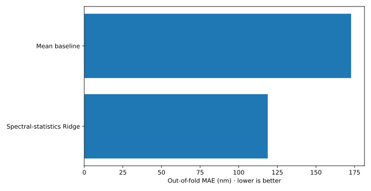
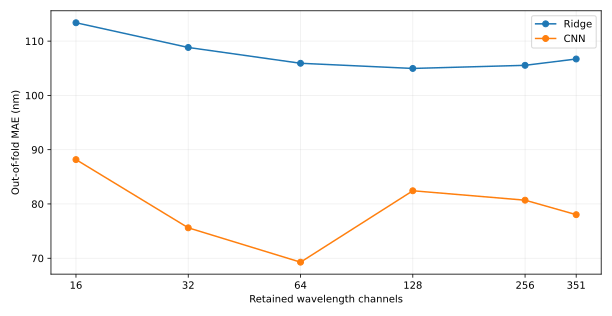
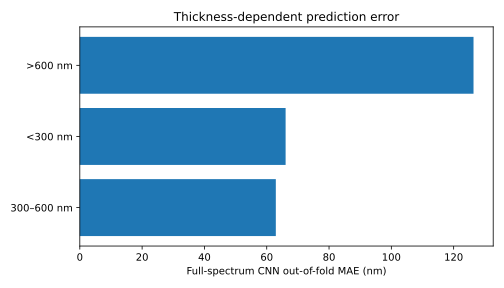
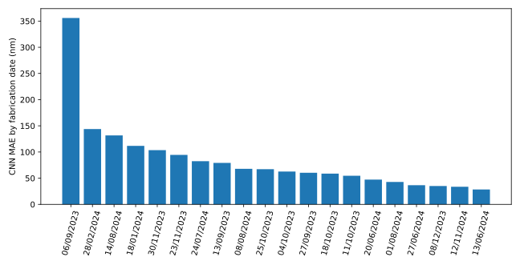
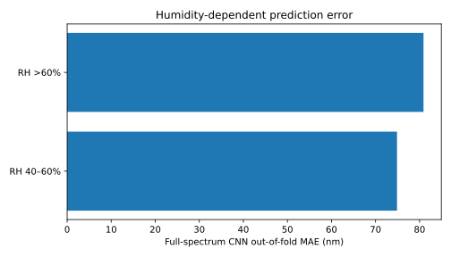

# PhotonIQ v2 — Five-fold experimental validation

**Source:** [Zenodo 10.5281/zenodo.19237616](https://zenodo.org/records/19237616) · Original source SHA-256 `c79b616d2c998977557cf72017c00f10b60a953570fe939932d025b208a2eb62`.

## Study design

- **517 real measured films**, 351 measured optical-density wavelengths from 300–1000 nm, and **20 fabrication dates**.
- **Five-fold GroupKFold by fabrication date**; each fold tests four dates and keeps all films from that date outside training and validation. Every film receives exactly **one out-of-fold prediction**.
- Validation dates also remain disjoint from training dates. **Thirty separate CNN models**, one per *fold × wavelength budget*. Training set normalization is refit in each fold/budget; no thickness-based feature engineering.
- **Uniform physical wavelength subsampling**: budgets of 16, 32, 64, 128, 256, and 351 channels. All sparse models are **retrained with their available channels**; this is not adaptive wavelength acquisition.
- Baselines: training-mean; Ridge on three direct spectral statistics; Ridge on each subsampled/full spectrum. Fixed regularization (`alpha=100`). CNN checkpoints chosen on validation loss only.
- The single-run published benchmark (50.91 nm MAE) used a **different train/test split** and is not directly interchangeable with the five-fold results.

## Out-of-fold results

| Model | Pooled MAE (nm) ↓ | RMSE (nm) ↓ | R² ↑ | Mean ± SD across 5 fold MAEs (nm) |
|---|---:|---:|---:|---:|
| Mean baseline | 172.77 | 234.62 | -0.048 | 172.74 ± 46.59 |
| Three optical-density statistics + Ridge | 118.80 | 191.08 | 0.305 | 118.85 ± 34.26 |
| Ridge - 16 wavelengths | 113.38 | 190.05 | 0.313 | 113.51 ± 28.32 |
| CNN - 16 wavelengths | 88.17 | 147.43 | 0.586 | 87.88 ± 24.95 |
| Ridge - 32 wavelengths | 108.83 | 185.87 | 0.343 | 108.94 ± 23.68 |
| CNN - 32 wavelengths | 75.61 | 139.72 | 0.628 | 75.34 ± 22.57 |
| Ridge - 64 wavelengths | 105.92 | 182.15 | 0.369 | 106.00 ± 21.28 |
| CNN - 64 wavelengths | 69.28 | 127.95 | 0.688 | 69.08 ± 19.84 |
| Ridge - 128 wavelengths | 104.97 | 180.41 | 0.381 | 105.04 ± 19.89 |
| CNN - 128 wavelengths | 82.43 | 153.56 | 0.551 | 82.11 ± 30.23 |
| Ridge - 256 wavelengths | 105.54 | 179.87 | 0.384 | 105.62 ± 18.24 |
| CNN - 256 wavelengths | 80.70 | 146.21 | 0.593 | 80.37 ± 28.64 |
| Ridge - 351 wavelengths | 106.71 | 180.48 | 0.380 | 106.81 ± 17.23 |
| CNN - 351 wavelengths | 78.03 | 138.23 | 0.636 | 77.65 ± 28.11 |

**Full 351-channel CNN:** **78.03 nm MAE**, **138.23 nm RMSE**, **R² 0.636**, compared with Ridge MAE **106.71 nm** (a **26.9%** relative reduction on these out-of-fold predictions).

**Sparse 64-channel CNN:** **69.28 nm MAE**, **R² 0.688** using only **18.2%** of the full wavelength budget; the observed MAE was 11.2% lower than the full CNN in this experiment. This is an **exploratory selection among six tested budgets**, not a guaranteed optimal sensing policy. No nested test set was reserved for selecting the budget.





## Uncertainty (descriptive date-cluster bootstrap)

Using 10,000 resamples of **20 fabrication-date groups** on saved out-of-fold predictions:

| Quantity | 2.5–97.5 percentile interval |
|---|---:|
| CNN full-spectrum MAE | 56.73–105.77 nm |
| Ridge full-spectrum MAE | 75.56–146.27 nm |
| CNN relative MAE reduction vs. Ridge | 3.0–44.3% |

This is **not** an externally calibrated uncertainty interval; it treats fabrication dates as resampling clusters on one observational dataset. It does not address future laboratory or process shifts.

## Diagnostics — where the model fails

| Thickness bin | Test films | Full-spectrum CNN MAE | Prediction bias |
|---|---:|---:|---:|
| 300–600 nm | 277 | 62.92 nm | +18.76 nm |
| <300 nm | 123 | 66.06 nm | +12.24 nm |
| >600 nm | 117 | 126.38 nm | -60.86 nm |

The CNN **underestimates thicker films on average**. The 6 September 2023 fabrication date is a pronounced failure group (16 films; approximately 356 nm MAE). This demands follow-up, not concealment.





**Fabrication covariates:** stratified diagnostics are recorded for substrate and ambient relative humidity and blade temperature. Several subgroups are tiny (5–8 specimens) and cannot support causal conclusions. Only one perovskite composition label appears in this dataset; **cross-composition generalization has not been tested**.



## Reproduction and integrity checks

```bash
python -m pip install numpy pandas scikit-learn torch matplotlib pytest
python tools/advanced_benchmark.py /path/to/zenodo-Dataset.zip results/zenodo_2026/advanced_cv \
  --folds 5 --epochs 150 --bootstrap 10000
python tools/verify_advanced_results.py results/zenodo_2026/advanced_cv
```

The benchmark code, CI training workflow, and three synthetic-fixture tests are in the repository. Outputs include the **full train/validation/test manifest for each fold**, OOF predictions for all budgets, per-fold metrics, subgroup diagnostics, a date-cluster bootstrap and trained CNN checkpoints for 64/351 channels in runtime artifacts. **Original raw source spectra and model weights are not committed to Git.** Reproduced numeric values can vary between PyTorch versions and hardware; audit source hash and training versions before comparing runs.

**Study limitations:** one source dataset; only 20 fabrication-date groups; process/laboratory confounding; test folds reused for exploratory comparison among six channel budgets; no independent follow-up dataset; no deployed optical instrument; and no physical-law constraints in CNN loss. The separate Mendeley dataset remains inaccessible to this automated runner and has not been evaluated.
